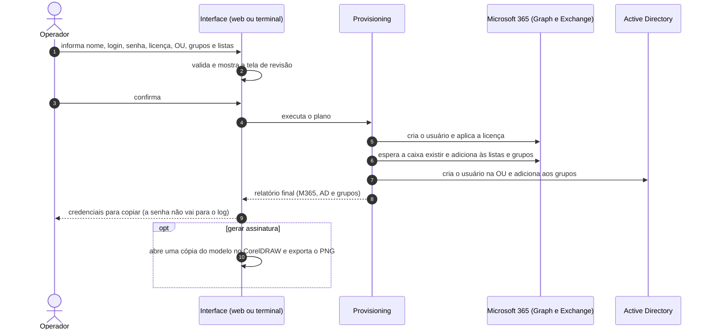
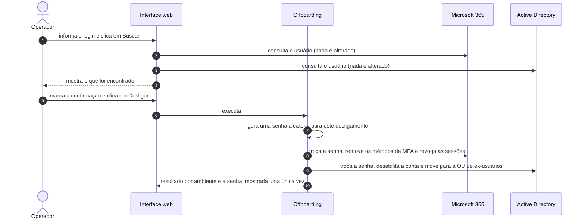

# Provisionamento de Usuários: Microsoft 365 e Active Directory

## Sumário

1. [Objetivo](#1-objetivo)
2. [Stack](#2-stack)
3. [Arquitetura](#3-arquitetura)
    - 3.1. [Diagrama de fluxo](#31-diagrama-de-fluxo)
    - 3.2. [Estrutura de diretório](#32-estrutura-de-diretório)
    - 3.3. [Segurança](#33-segurança)
4. [Variáveis de configuração](#4-variáveis-de-configuração)
5. [Infraestrutura e execução](#5-infraestrutura-e-execução)
6. [Guia do desenvolvedor](#6-guia-do-desenvolvedor)

> **Projeto de portfólio.** Nasceu de uma rotina real de TI. Nomes, domínios, OUs, servidores, filiais (`MTZ`, `FL1`, `FL2`, `FL3`) e caminhos de rede deste repositório são **exemplos fictícios** (`contoso.com`, `corp.contoso.local`). Os IDs do tenant são zeros e o `config.json` real fica fora do git.

## 1. Objetivo

Automatiza a **entrada e a saída de colaboradores** em dois ambientes que **não são sincronizados** (sem Entra Connect): o Microsoft 365 e o Active Directory local. Cada um é tratado de forma independente, por uma interface web local ou por um assistente de terminal.

| Ambiente | Módulo usado | Observação |
|---|---|---|
| Microsoft 365 / Entra ID | `Microsoft.Graph` | Sem AzureAD legado |
| Active Directory local | `ActiveDirectory` (RSAT) | Sem sincronização híbrida |

### 1.1. O que o sistema faz

| Função | Descrição |
|---|---|
| **Criar usuário** | Coleta os dados, valida (login, senha, duplicidade), cria no M365 com licença e listas de distribuição, cria no AD na OU escolhida e adiciona aos grupos |
| **Desligar usuário** | Troca a senha, remove os métodos de MFA, revoga as sessões (M365) e desabilita e move a conta para a OU de ex-usuários (AD). A senha é aleatória e única para cada desligamento |
| **Assinatura de e-mail** | Gera a assinatura (PNG transparente de 300 dpi) a partir de modelos do CorelDRAW, escolhendo o modelo pela OU do usuário, e opcionalmente guarda uma cópia na rede |
| **Modo demonstração** | Roda a interface inteira com dados fictícios, sem conectar a nada e sem criar nada |
| **Logs e relatório** | Log diário sem senhas e relatório final de cada operação |

### 1.2. Regras de negócio

| Regra | Comportamento |
|---|---|
| Login | Sempre digitado pelo operador |
| E-mail | Gerado a partir do login: `LOGIN@dominio` |
| Login duplicado no AD, e-mail duplicado no M365 | Bloqueados antes de continuar |
| Senha informada | No mínimo 8 caracteres, com maiúscula, minúscula, número e símbolo |
| Conta no AD | `PasswordNeverExpires` ligado, `ChangePasswordAtLogon` desligado |
| Localização de uso (M365) | `BR` (configurável) |
| Sincronização híbrida | Nunca: os dois ambientes ficam independentes |
| Listas de distribuição | Aceita vírgula, ponto e vírgula, espaço, uma por linha, alias sem domínio e o formato colado do Outlook. Cada lista é conferida no Exchange antes da criação |
| Caixa no Exchange | Depois de licenciar, o script espera a caixa existir (até `DistributionListWaitSeconds`) antes de adicionar às listas |

## 2. Stack

| Camada | Tecnologia |
|---|---|
| Linguagem | PowerShell 7 |
| Microsoft 365 | `Microsoft.Graph` 2.x (login interativo com um aplicativo registrado no Entra ID) e Exchange Online |
| Diretório | `ActiveDirectory` (RSAT), com controlador de domínio principal e de contingência |
| Interface web | HTML, CSS e JavaScript puros, servidos por `HttpListener` só em `localhost` |
| Interface de terminal | Assistente com etapas, voltar, editar e revisão antes de criar |
| Assinatura | CorelDRAW por COM (modelos `.cdr`) |

## 3. Arquitetura

### 3.1. Diagrama de fluxo

Criação de usuário:



Desligamento:



### 3.2. Estrutura de diretório

```
web.ps1                  Interface web (HttpListener em localhost, -Demo, -NoBrowser, -Port)
web/index.html           Página da interface web
main.ps1                 Interface de terminal
bootstrap.ps1            Carga comum de módulos e configuração (usada pelos dois acima)
setup.ps1                Instala os módulos e confere a configuração (rode uma vez)
config.example.json      Modelo da configuração (copie para config.json)
criar-atalho.ps1         Cria os atalhos "Criar Usuários" (Área de Trabalho e Menu Iniciar)
iniciar-web.cmd          Atalho de duplo clique para web.ps1
Instalar atalhos.cmd     Cria os atalhos a partir do cmd
modules/
    Logger.psm1          Log diário, com retenção
    Validator.psm1       Validações (login, senha, duplicidade, controladores de domínio)
    UI.psm1              Assistente do terminal
    M365User.psm1        Graph e Exchange: usuário, licença, listas e grupos
    ADUser.psm1          Active Directory: usuário e grupos
    Provisioning.psm1    Executa o plano completo (usado pelo terminal e pela web)
    Offboarding.psm1     Desligamento no M365 e no AD
    Signature.psm1       Assinatura de e-mail (CorelDRAW para PNG)
    Report.psm1          Relatório final
logs/                    Criado automaticamente (provisioning_AAAA-MM-DD.log, fora do git)
```

### 3.3. Segurança

- Nenhuma credencial é guardada em arquivo. A autenticação no Microsoft 365 é OAuth 2.0 interativa.
- A interface web escuta **apenas em `localhost`**, e cada execução gera uma chave própria no link aberto, então outras abas e sites não conseguem usar a API.
- As senhas existem só em memória: não vão para o log e somem ao fechar a tela.
- No desligamento, a senha é **aleatória e diferente a cada vez** (16 caracteres, gerador criptográfico). Uma senha padrão previsível seria um risco, por isso ela não existe.
- O `config.json` tem só identificadores (TenantId, ClientId), não segredos, e mesmo assim fica fora do git. Para produção, o próprio arquivo sugere Azure Key Vault ou o Gerenciador de Credenciais do Windows.
- Os escopos do Graph são os mínimos para a tarefa (veja a seção 4).

## 4. Variáveis de configuração

Tudo fica em `config.json` (copie `config.example.json` e ajuste):

| Chave | Descrição |
|---|---|
| `Domain` | Domínio dos e-mails do Microsoft 365 |
| `TenantId`, `ClientId` | Diretório e aplicativo registrado no Entra ID |
| `ADDomain`, `ADPrimaryServer`, `ADFallbackServer` | Domínio do AD, controlador principal e de contingência (o script tenta o principal e cai para o outro) |
| `ADDefaultOU`, `ADUserOUs` | OU padrão e lista de OUs que aparecem no menu (rótulo e DN) |
| `ADExUsersOU` | DN da OU de ex-usuários. Vazio: o script procura uma OU chamada `Ex-Usuários` |
| `UsageLocation` | País de uso das licenças (`BR`) |
| `DistributionListWaitSeconds` | Espera máxima pela caixa no Exchange antes de adicionar às listas (padrão 300) |
| `LogRetentionDays` | Dias de retenção dos logs (padrão 90) |
| `Signature` | Pasta dos modelos `.cdr`, pasta de destino, `CorelProgId` (2020 = `CorelDRAW.Application.22`) e a lista de modelos, cada um ligado a uma OU (`OUMatch`) |
| `GraphScopes` | Escopos pedidos ao Graph (`User.ReadWrite.All`, `Directory.ReadWrite.All`, `Organization.Read.All` e, para o desligamento, `UserAuthenticationMethod.ReadWrite.All` e `User.RevokeSessions.All`) |

## 5. Infraestrutura e execução

Roda na máquina do administrador (Windows), com acesso de rede ao controlador de domínio (rede interna ou VPN). Não há servidor.

**Pré-requisitos:** PowerShell 7, `Microsoft.Graph` 2.x, RSAT com o módulo `ActiveDirectory`, e um aplicativo registrado no Entra ID.

**Aplicativo no Entra ID:**
1. Em **App registrations → New registration**, escolha **Single tenant** e o redirect URI `http://localhost` (cliente público).
2. Em **API permissions → Microsoft Graph → Delegated**, adicione os escopos de `GraphScopes` e dê **Grant admin consent**.
3. Quem desliga usuários precisa do papel *Authentication Administrator* (ou superior).

**Primeira execução:**

```powershell
cd C:\Scripts\UserProvisioning
Copy-Item config.example.json config.json    # e preencha com o seu ambiente
pwsh -File setup.ps1                         # instala os módulos e confere a configuração
pwsh -File web.ps1 -Demo                     # testa a interface sem conectar a nada
pwsh -File web.ps1                           # uso real (ou duplo clique em iniciar-web.cmd)
pwsh -File main.ps1                          # alternativa: assistente de terminal
```

O `web.ps1` faz o login no Microsoft 365, conecta ao AD e abre o navegador em `http://localhost:8765`. Deixe a janela do PowerShell aberta enquanto usa a página, e use o botão **Encerrar** para desconectar as sessões.

## 6. Guia do desenvolvedor

- **Interface web:** etapas clicáveis, **Voltar/Avançar**, revisão com **Editar** em cada item, botão **Desligamento** (Buscar, confirmar, Desligar) e **Só assinatura** para quem já existe.
- **Terminal:** **V** volta, **X** cancela, **ENTER** mantém o valor, e nada é criado antes da revisão.
- **Modo demonstração:** `web.ps1 -Demo`. Licenças, grupos e listas são fictícios. A assinatura é gerada de verdade se o CorelDRAW estiver instalado, mas "salvar cópia na rede" fica desativado.
- **`-NoBrowser` e `-Port`:** para rodar sem abrir o navegador ou em outra porta.
- **Assinatura:** abre uma **cópia** do modelo com o Corel oculto, troca nome e e-mail e exporta o PNG. Os modelos originais nunca são alterados, e a cópia na rede nunca sobrescreve.

**Solução de problemas**

| Erro | Causa provável | Solução |
|---|---|---|
| `config.json não encontrado` | Falta copiar o modelo | `Copy-Item config.example.json config.json` e preencher |
| `Módulo não encontrado` | Microsoft.Graph não instalado | Rode `setup.ps1` |
| `Falha na autenticação Graph` | TenantId ou ClientId errados | Confira `config.json` |
| `Não foi possível conectar ao AD` | Controlador incorreto ou sem rede | Confira VPN, rede e `config.json` |
| Erro ao adicionar às listas | Caixa ainda não existe no Exchange | Aumente `DistributionListWaitSeconds` |
| Assinatura não gera | CorelDRAW ausente ou `CorelProgId` diferente | Confira a versão instalada e `Signature.CorelProgId` |
| Modelo `.cdr` não encontrado | Pasta de rede indisponível | Confira o acesso à pasta de `Signature.TemplatesFolder` |

**O que foi verificado e o que não foi.** Todos os arquivos passam na análise de sintaxe do PowerShell 7, e o modo demonstração sobe e serve a página (`HTTP 200`). Não há testes automatizados, e **as operações reais contra o Microsoft 365 e o Active Directory não foram executadas depois da limpeza para este repositório**: valide em um ambiente de teste, com o modo demonstração e uma conta de teste, antes de usar em produção.

**Expansões planejadas**

- [ ] Importação em massa por CSV
- [ ] Interface gráfica WPF
- [ ] Modelos por departamento
- [ ] Offboarding agendado e em lote
- [ ] Integração com GLPI e SharePoint
- [ ] Relatório HTML de auditoria
- [ ] Azure Key Vault para as credenciais
- [ ] Testes automatizados (Pester)
